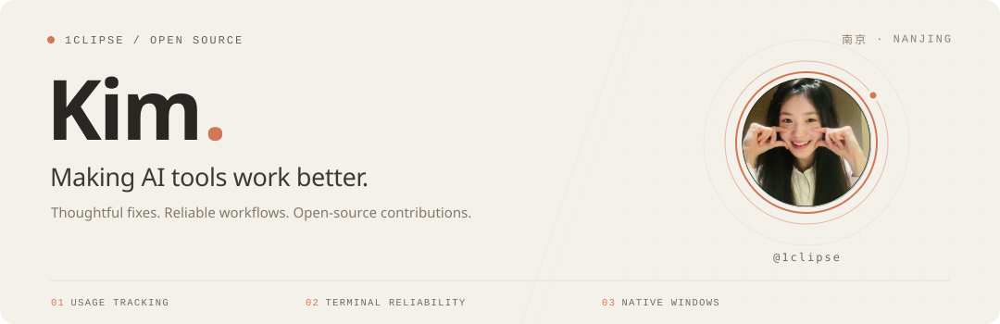

  

  
  &nbsp;
  
  &nbsp;
  <picture></picture>

 

## A little about me

I'm **Kim**, based in **Nanjing, Jiangsu**. I contribute to open-source AI coding tools, with a focus on **usage tracking**, **terminal reliability**, and **native Windows support**.

I turn everyday frustrations into fixes others can use.

 

## Selected contributions

Three projects I use, improve, and contribute back to.

<table>
<tr>
<td width="33%" valign="top">

More reliable Codex usage tracking, without counting the same usage twice.

<strong>Merged</strong>

<ul>
  <li><a href="https://github.com/farion1231/cc-switch/pull/9093">#9093</a> — Recover fork usage after parent idle gaps.</li>
  <li><a href="https://github.com/farion1231/cc-switch/pull/9105">#9105</a> · <a href="https://github.com/farion1231/cc-switch/pull/9106">#9106</a> — Token-total tests and cleaner validation.</li>
</ul>

<strong>Open</strong>

<a href="https://github.com/farion1231/cc-switch/pull/9102">#9102</a> — Recover compaction timing without duplicate billing.

</td>
<td width="33%" valign="top">

Smoother terminal input and more resilient agent collaboration.

<strong>Merged</strong>

<a href="https://github.com/tt-a1i/hive/pull/46">#46</a> — Stabilize Codex input and cursor behavior; restore team access.

<strong>Open</strong>

<ul>
  <li><a href="https://github.com/tt-a1i/hive/pull/65">#65</a> — Switch orchestrator CLI after quota exhaustion.</li>
  <li><a href="https://github.com/tt-a1i/hive/pull/70">#70</a> — Restore Claude terminal scrolling on Windows.</li>
</ul>

</td>
<td width="33%" valign="top">

A more dependable native Windows experience for Claude Codex Bridge.

<strong>Merged</strong>

<ul>
  <li><a href="https://github.com/SeemSeam/claude_codex_bridge/pull/368">#368</a> — Improve startup, reconnect, and foreground input.</li>
  <li><a href="https://github.com/SeemSeam/claude_codex_bridge/pull/384">#384</a> — Protect config; add terminal checks and update rollback.</li>
</ul>

Changes kept within Windows-owned code and tooling.

</td>
</tr>
</table>

 

---

  <strong>Still learning. Still building.</strong> 
  <a href="https://x.com/Knight1v9">X: @Knight1v9</a> &nbsp;·&nbsp; Email: <code>kimziyi0416@gmail.com</code>

